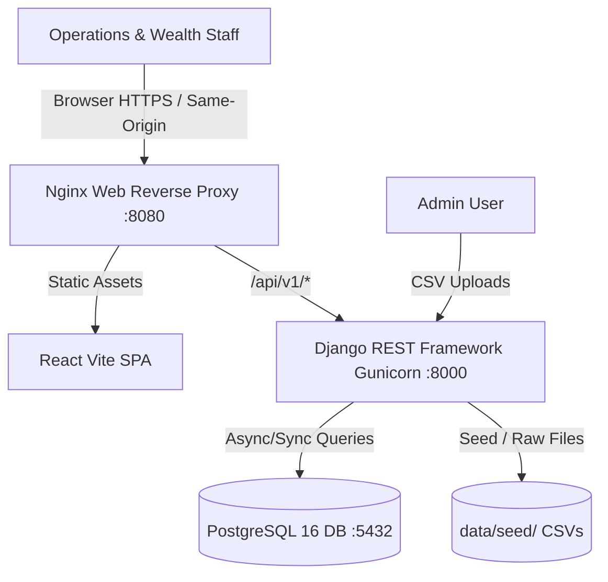
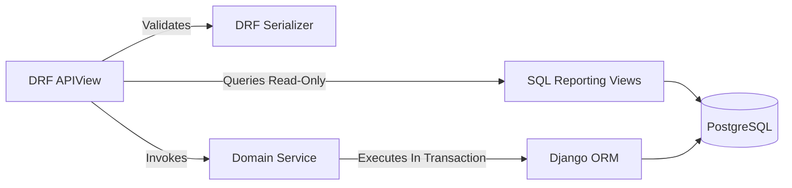
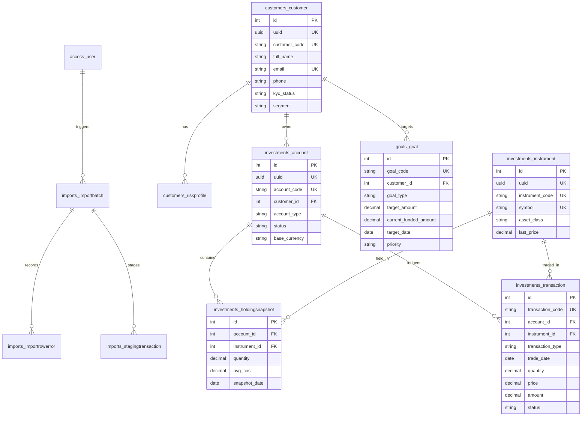
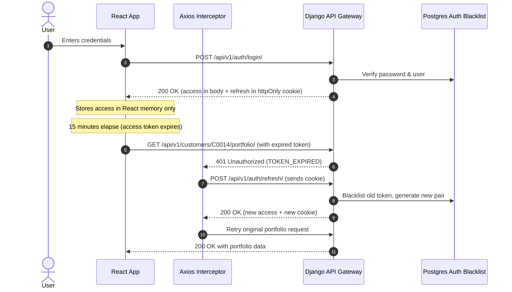
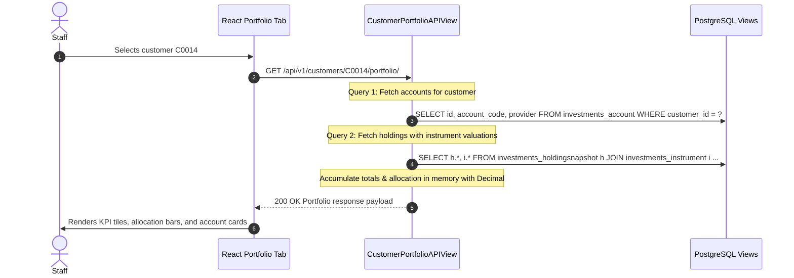
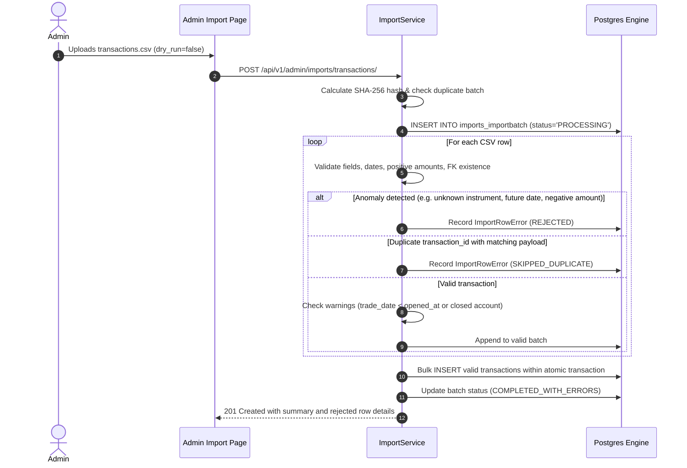

# FinPilot Architecture & Technical Report

**Product:** Internal Investment Portfolio & Goal Monitoring Platform  
**Target Audience:** Wealth Operations, Service Staff, Engineering Reviewers  
**Stack:** Django 5, DRF (JWT Auth), PostgreSQL 16, React 18 (TypeScript, Vite), Docker Compose

---

## 1. Executive Overview

FinPilot is a specialized back-office platform engineered for wealth management operations and advisory personnel. The platform centralizes client positions, multi-account holdings, live valuations, life goal milestones, and transaction histories into a single view. End-clients never authenticate; instead, firm employees manage customer portfolios under role-based boundaries (ADMIN and VIEWER).

Key Architectural Tenets:
- **Zero Float Financial Arithmetic**: All valuation, cost basis, and unrealised P/L aggregations use exact `Decimal` precision end-to-end.
- **SQL-Centric Aggregation**: Calculations are executed within PostgreSQL relational views rather than distributed over API workers or client JavaScript runtimes.
- **Strict Data Pipeline with Idempotency**: Automated CSV ingestion parses, validates, and reports row-level errors without corrupting the ledger.
- **Predictable Read Queries**: Core customer overview endpoints are optimized to resolve in $\le 3$ SQL queries regardless of how many positions or accounts are linked.

---

## 2. System Context



The system operates behind a unified origin via Nginx. In local development and production-like Docker Compose setups, the frontend proxies `/api/v1` traffic to Gunicorn on port 8000, eliminating cross-origin resource sharing complexities and cookie degradation across distinct domains.

---

## 3. Component Architecture

The backend adheres to a strict four-layer architecture:
1. **Views**: Coordinate HTTP transport, enforce throttles, and unpack authentication contexts (`AppAPIView` and `AppModelListAPIViewSet`).
2. **Serializers**: Handle request validation, field mapping, and formatting without containing business logic.
3. **Services**: Encapsulate transaction boundaries, state transitions, sequence generations, and CSV ingestion workflows (`ImportService`).
4. **Selectors / Views**: Pre-aggregated database structures and indexed queries delivering high-throughput reads.



---

## 4. Entity Relationship Diagram (Data Model)



---

## 5. API Design & Security Boundaries

All endpoints are standardized under `/api/v1/` and wrapped in a consistent envelope:

```json
{
  "data": {},
  "status": "success",
  "action_code": "DO_NOTHING"
}
```

### Authentication Protocol
1. **Login (`POST /api/v1/auth/login/`)**:
   - Accepts email and password.
   - Throttled at 10 requests per minute per IP.
   - Returns short-lived (15 min) JWT `access` token in response body.
   - Sets rotated (7 day) `finpilot_refresh` cookie with `httpOnly`, `SameSite=Lax`, and `Path=/api/v1/auth/`.
2. **Silent Refresh (`POST /api/v1/auth/refresh/`)**:
   - Invoked single-flight by client axios interceptor when access expires.
   - Blacklists previous refresh token and issues fresh access + refresh pair.
3. **Role Authorization**:
   - `VIEWER`: Read access to customers, portfolios, ledgers; write access to goals.
   - `ADMIN`: Inherits VIEWER capabilities plus access to `/api/v1/admin/imports/*` and `/api/v1/admin/data-quality/`.

---

## 6. End-to-End Workflow Sequence Diagrams

### Flow 1: Authentication & Single-Flight Token Refresh



### Flow 2: Customer Portfolio Read (Guaranteed $\le 3$ Queries)



### Flow 3: CSV Ingestion Pipeline & Anomaly Handling



---

## 7. Deployment Topology & Production Mapping

### Local Containerized Setup
- `db`: PostgreSQL 16 on standard port 5432 with health check.
- `api`: Python 3.13 slim container, running non-root `appuser`, serving Gunicorn on port 8000.
- `web`: Nginx alpine container on port 8080 serving built static assets and proxying `/api/` to `api:8000`.

### Enterprise Cloud Production Topology
1. **Compute Layer**: AWS ECS Fargate or Google Cloud Run autoscaling containers behind an Application Load Balancer.
2. **Database Layer**: AWS RDS PostgreSQL 16 (Multi-AZ) with automated nightly snapshots, WAL archiving for Point-In-Time Recovery (PITR), and read-replicas for reporting queries.
3. **Connection Pooling**: PgBouncer deployed in transaction pooling mode with `DISABLE_SERVER_SIDE_CURSORS=True`.
4. **Storage & Ingestion**: AWS S3 private bucket for uploaded CSV artifacts; Celery worker pool processing asynchronous queues via Redis/SQS for files exceeding 50,000 rows.
5. **Secret Management**: AWS Secrets Manager injecting database passwords and JWT signing keys at container initialization.

---

## 8. Security & Reliability

- **No User Enumeration**: Login failures return a generic `"Invalid email or password."` message regardless of whether the email exists.
- **CSRF & XSS Hardening**: Refresh tokens reside strictly in httpOnly, SameSite=Lax cookies with path restrictions. Access tokens are kept in memory and never written to `localStorage`.
- **SQL Injection Defense**: All user inputs are parameterized via the Django ORM. Custom views are statically defined in migrations and never evaluated via runtime string formatting.
- **PII Protection**: Customer phone numbers and emails are masked in stdout application logs. Customer overview queries trigger structured audit log records (`customer.viewed`).

---

## 9. Reliability & Operations

- **Readiness Probes**: `/api/v1/health/ready/` actively issues `SELECT 1` to PostgreSQL and evaluates whether any pending migrations remain unapplied before accepting load balancer traffic.
- **Circuit Breakers**: API operations enforce database `statement_timeout` (15s) and Gunicorn worker timeouts (60s). Axios clients implement a 30s timeout with a single automatic retry on idempotent GET failures.

---

## 10. Trade-Offs & Roadmap

1. **Synchronous Ingestion vs. Distributed Worker Queues**:
   - *Current*: Files with ~5,000 rows parse in < 3 seconds synchronously, minimizing infrastructure complexity.
   - *Roadmap*: Offload large ingestion workloads to background Celery tasks with WebSocket progress updates.
2. **Snapshot Valuation vs. Reconstructed Ledger**:
   - *Current*: `holdings_snapshot` serves as the authoritative source of portfolio truth, preventing discrepancies from synthetic transaction sets.
   - *Roadmap*: Implement an automated reconciliation engine to highlight discrepancies between settled transactions and snapshot balances.
